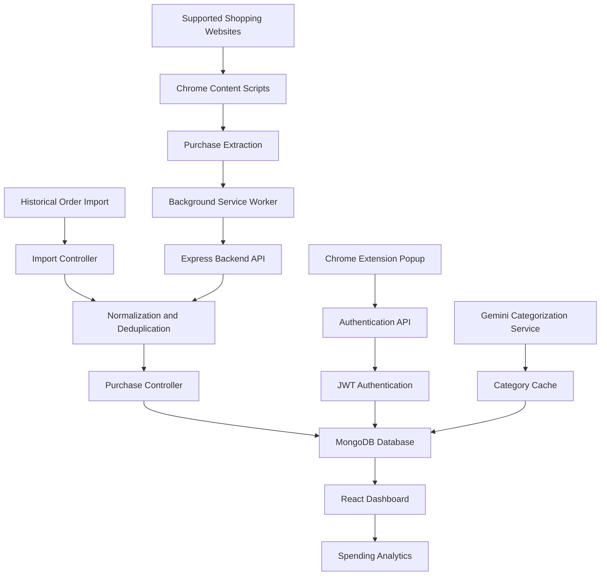

# SpendWise — Smart Shopping Expense Analyzer

SpendWise is a Chrome extension designed to simplify online shopping expense tracking. It extracts purchase information from supported shopping platforms, categorizes expenses, synchronizes purchase data with a backend, and presents spending insights through a dashboard.

By combining real-time purchase detection with historical order imports, SpendWise aims to provide users with a consolidated view of their online shopping expenses while minimizing manual data entry and duplicate records.

## Features

- **Automatic Purchase Detection:** Extract purchase details from supported shopping websites.
- **Historical Order Import:** Import past orders from supported platforms.
- **Expense Categorization:** Organize purchases into meaningful spending categories.
- **AI-Assisted Categorization:** Use Google's Gemini API to assist with product categorization, with MongoDB caching to reuse previous classifications.
- **Spending Dashboard:** View actual purchase data and spending analytics through a React dashboard.
- **User Authentication:** Register and sign in through the Chrome extension.
- **Secure Password Handling:** Hash user passwords on the backend.
- **Centralized Data Storage:** Store user and purchase records in MongoDB.
- **Duplicate Prevention:** Use purchase deduplication to reduce duplicate records from real-time detection and historical imports.
- **Wallet Top-Up Exclusion:** Exclude Amazon Pay balance top-ups from expenditure calculations.
- **Modular Architecture:** Separate extension scripts, frontend components, backend APIs, and data models.

## Supported Shopping Platforms

SpendWise is designed to support purchase extraction from:

- Amazon

Extraction behavior depends on the structure and availability of purchase information on each website. Website changes may require updates to the extraction logic.

## Expense Categories

SpendWise supports the following expense categories:

- Groceries
- Personal Care
- Clothing
- Footwear
- Electronics
- Books & Education
- Home & Kitchen
- Health & Wellness
- Beauty
- Quick Commerce
- Uncategorized

### Special categorization rules

- Amazon Fresh purchases are categorized as **Groceries**.
- Amazon Now purchases are categorized as **Quick Commerce**.
- Amazon Pay balance top-ups are excluded from expenditure because adding money to a wallet is not itself a purchase.
- Product records without sufficient information for reliable categorization may require a fallback category.

## System Architecture



### Data flow

1. Content scripts extract available purchase information from supported shopping websites.
2. The extension processes purchase data and communicates with the backend.
3. Historical order imports enter the same overall purchase-processing workflow.
4. Purchase records are normalized and checked for duplicates before being stored.
5. Categorization logic assigns expense categories, using the Gemini service and cached results where applicable.
6. The Express backend stores and retrieves purchase data in MongoDB.
7. The React dashboard displays spending information obtained from the backend.

## Technology Stack

| Component         | Technologies                              |
| ----------------- | ----------------------------------------- |
| Browser extension | JavaScript, HTML, CSS, Chrome Manifest V3 |
| Frontend          | React, Vite                               |
| Backend           | Node.js, Express.js                       |
| Database          | MongoDB, Mongoose                         |
| Authentication    | JWT                                       |
| Password hashing  | bcrypt                                    |
| AI categorization | Google Gemini API                         |
| Build tooling     | Vite, npm                                 |
| Version control   | Git, GitHub                               |

## Project Structure

```text
SpendWise/
├── manifest.json
├── package.json
├── package-lock.json
├── vite.config.js
├── .gitignore
├── server/
│   ├── app.js
│   ├── server.js
│   ├── config/
│   │   └── db.js
│   ├── controllers/
│   │   ├── auth.controller.js
│   │   ├── categorization.controller.js
│   │   ├── import.controller.js
│   │   └── purchase.controller.js
│   ├── middleware/
│   │   ├── auth.middleware.js
│   │   └── error.middleware.js
│   ├── models/
│   │   ├── CategoryCache.js
│   │   ├── Purchase.js
│   │   └── User.js
│   ├── routes/
│   │   ├── auth.routes.js
│   │   ├── categorization.routes.js
│   │   ├── import.routes.js
│   │   └── purchase.routes.js
│   ├── scripts/
│   │   ├── create-amazon-history-expectations.js
│   │   └── verify-amazon-history-import.js
│   ├── services/
│   │   ├── deduplicationService.js
│   │   └── geminiService.js
│   └── tests/
│       ├── auth-api.test.js
│       ├── import-api.test.js
│       └── realtime-purchase.test.js
└── src/
    ├── background/
    │   └── background.js
    ├── content-scripts/
    │   ├── contentScriptEntry.js
    │   └── extractors/
    │       └── generic.js
    ├── dashboard/
    │   ├── Dashboard.jsx
    │   ├── index.html
    │   └── index.jsx
    ├── popup/
    │   ├── Popup.jsx
    │   ├── index.html
    │   └── index.jsx
    ├── shared/
    │   ├── constants.js
    │   └── mockData.js
    └── styles/
        └── styles.css
```

The repository also contains configuration and test-support files, including `amazon-history-fixture.json`. Generated directories such as `dist/`, `node_modules/`, and local virtual environments are not shown.

## Getting Started

### Prerequisites

Install the following:

- Node.js and npm
- MongoDB or a MongoDB Atlas database
- Google Chrome
- Git
- A Gemini API key if AI-assisted categorization is enabled

### 1. Clone the repository

```bash
git clone <YOUR_GITHUB_REPOSITORY_URL>
cd SpendWise
```

Replace the placeholder with the URL of your GitHub repository.

### 2. Install dependencies

From the project root:

```bash
npm install
```

If the backend has its own dependency manifest in your current setup, install those dependencies as well.

### 3. Configure environment variables

Create the environment file expected by the backend configuration and set the required values.

Depending on your current implementation, these may include:

- MongoDB connection URI
- Backend port
- JWT signing secret
- Gemini API key

Use the exact variable names expected by the existing source code. Do not commit `.env` files, database credentials, API keys, or JWT secrets to GitHub.

### 4. Start the backend

Start the backend using the script configured in the root `package.json`:

```bash
npm run server
```

If your current package scripts use a different command, use the corresponding configured script.

Confirm that the server starts and connects successfully to MongoDB.

### 5. Build the extension

Run the production build:

```bash
npm run build
```

The Vite configuration outputs the built extension to `dist/`.

### 6. Load the extension in Chrome

1. Open `chrome://extensions`.
2. Enable **Developer mode**.
3. Select **Load unpacked**.
4. Select the generated `dist/` directory.
5. Pin SpendWise to the toolbar if desired.
6. Open the extension popup.

If the extension is already installed, select **Reload** after rebuilding it.

### 7. Register or sign in

1. Open the SpendWise popup.
2. Choose **Create Account** to register a new user, or **Sign In** for an existing account.
3. Enter the requested credentials.
4. Open the dashboard after authentication.
5. Verify that the dashboard displays the authenticated user's purchase data.

The backend must be running and its database connection must be configured correctly.

## Running Tests

The project includes automated backend tests for authentication, historical imports, and real-time purchase handling.

Run the complete Node.js test suite:

```bash
node --test server/tests/*.test.js
```

Build the production extension:

```bash
npm run build
```

These commands check the automated tests and production build. Live database persistence and extraction against real shopping websites should be verified in the target environment.

## Security and Privacy

SpendWise handles authentication information and shopping-related purchase data. Important security considerations include:

- Passwords must be hashed before being stored.
- Protected endpoints must validate authentication.
- Database credentials and API keys must remain secret.
- Purchase queries must be scoped to the authenticated user.
- Extracted purchase data must be validated by the backend.
- Extension permissions should be limited to the websites and capabilities needed by the application.
- Sensitive information should not be logged or exposed in API responses.

Users should review the extension's permissions and understand what purchase information it accesses before using it.

## Future Improvements

Potential improvements include:

- Support for additional shopping platforms.
- More advanced spending trends and reports.
- Monthly budgets and spending alerts.
- Exportable expense summaries.
- Additional automated integration tests.
- Further improvements to product categorization accuracy.

## These are possible future enhancements, not a list of features that users should assume are already available.

**SpendWise — Making online shopping expenses easier to understand.**
